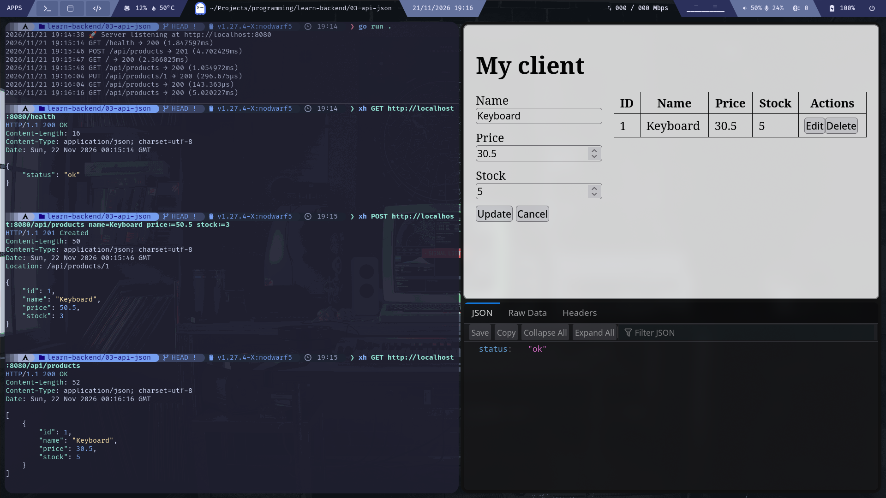

# 🗺️ Roadmap para aprender Backend con Go

## 🛠️ Herramientas de Testing y Desarrollo

- **[Hurl](https://hurl.dev/):** Para pruebas de integración HTTP basadas en ficheros planos.
- **[xh](https://github.com/ducaale/xh):** Una alternativa rápida y amigable a `curl` para pruebas rápidas.

## Fase 1 - Enrutamiento y handlers

Construcción de un servidor simple: un solo binario que escucha y responde. El objetivo es entender qué pasa entre que llega una petición y sale la respuesta.

Carpeta: `01-server/`

- Server (Go)

## Fase 2 - MVC, formularios HTML y plantillas

El proyecto ya no cabe en un archivo: la lógica se organiza en models, controllers y views, y las respuestas ganan estructura gracias a las plantillas.

Carpeta: `02-server-client/`

- Server (Go)
- Client (views)

## Fase 3 - API JSON, middlewares y consumo con fetch

El servidor deja de solo pintar páginas: expone una API que habla JSON con los cinco verbos, y el navegador la consume con fetch.

Carpeta: `03-api-json/`

- Server (Go)
  - JSON (consumo de APIs)
  - Middlewares (Logger, Recover)
- Client (views)

