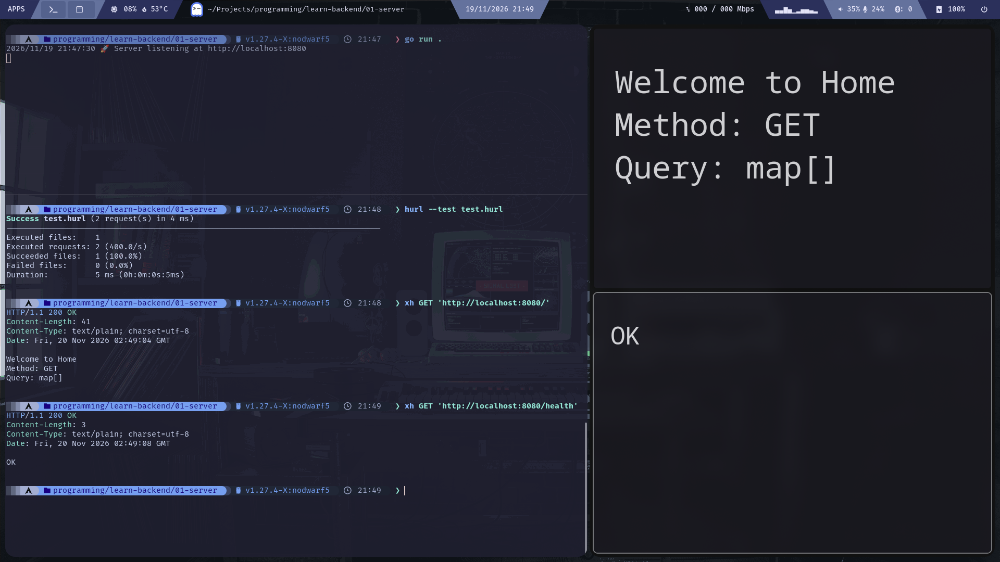
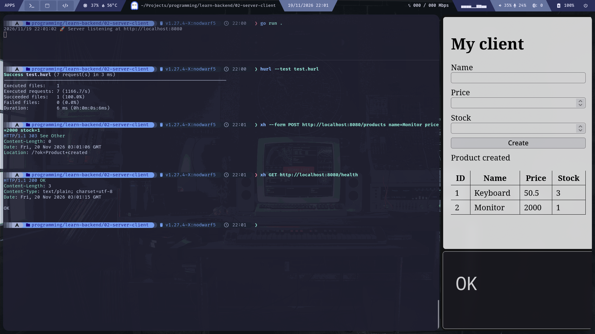
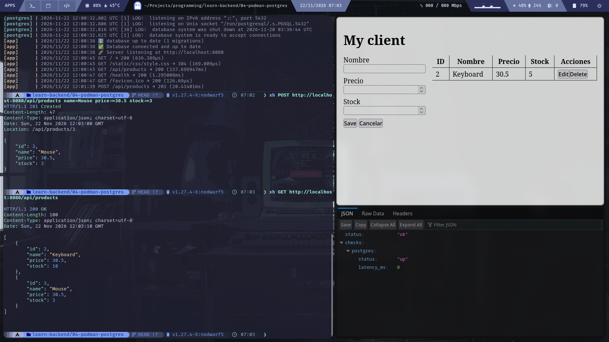
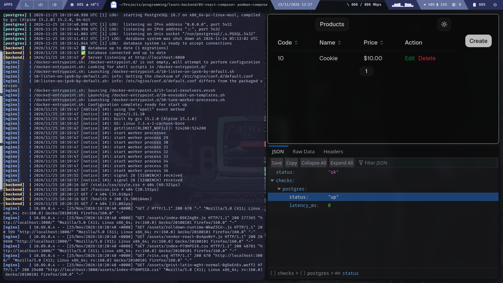

# 🗺️ Roadmap para aprender Backend con Go

## Fase 1 - Enrutamiento y handlers

Construcción de un servidor simple: un solo binario que escucha y responde. El objetivo es entender qué pasa entre que llega una petición y sale la respuesta.

Carpeta: `01-server/`

- **Server (Go)**

## Fase 2 - MVC, formularios HTML y plantillas

El proyecto ya no cabe en un archivo: la lógica se organiza en models, controllers y views, y las respuestas ganan estructura gracias a las plantillas.

Carpeta: `02-server-client/`

- Server (Go)
- **Client (views)**

## Fase 3 - API JSON, middlewares y consumo con fetch

El servidor deja de solo pintar páginas: expone una API que habla JSON con los cinco verbos, y el navegador la consume con fetch.

Carpeta: `03-api-json/`

JSON · Middlewares

- Server (Go)
  - **JSON (consumo de APIs)**
  - **Middlewares (Logger, Recover)**
- Client (views)

## Fase 4 - PostgreSQL, redes en Podman y migraciones

El dato sobrevive al reinicio: el server se contenedoriza, una base de datos entra en escena y los contenedores aprenden a hablar entre sí.

Carpeta: `04-podman-postgres/`

Lo nuevo · Postgres · Compose

- Client (views)
- **Podman Compose:**
  - **PostgreSQL**
  - Server (Go)
    - JSON (consumo de APIs)
    - Middlewares (Logger, Recover)
    - **Migrations**

## Fase 5 - React y Nginx

El cliente da el salto a React y el stack gana un nuevo servicio: Nginx entra como puerta de entrada. En desarrollo, Vite corre en el host con proxy a la api; en el stack, Nginx sirve el `dist/` construido.

Carpeta: `05-react-compose/`

Lo nuevo · React · Nginx

- Podman Compose:
  - PostgreSQL
  - Server (Go)
    - JSON (consumo de APIs)
    - Middlewares (Logger, Recover)
    - Migrations
  - **Nginx (dist/ + /api)**
    - **Client (layer-based)**
      - **React & Vite**
      - **1 api (products)**

