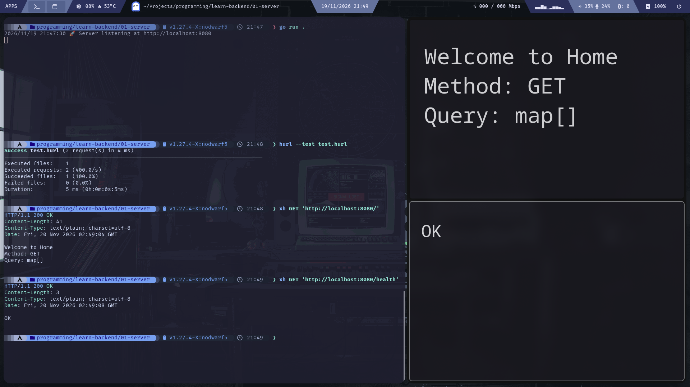
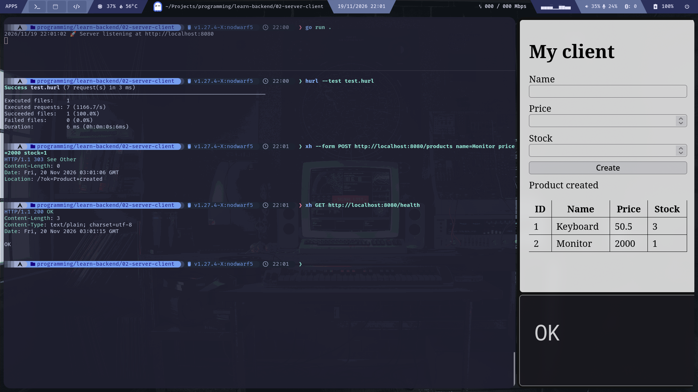
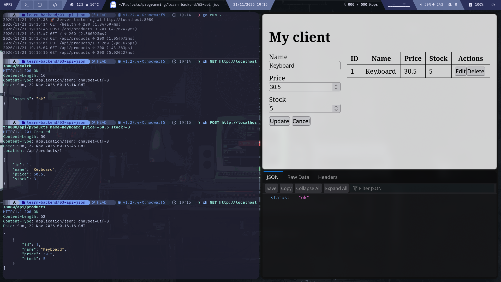
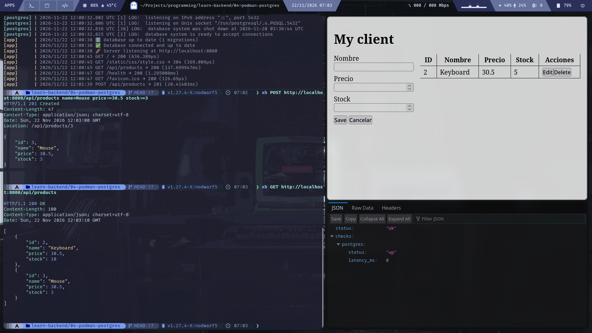
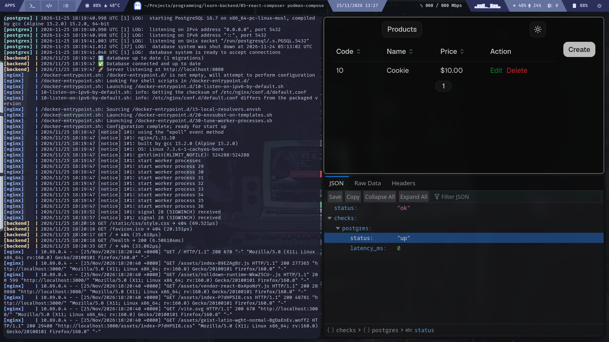

# 🗺️ Roadmap for Learning Backend Development with Go

## 🛠️ Testing and Development Tools

- **[Hurl](https://hurl.dev/):** For HTTP integration testing using plain-text files.
- **[xh](https://github.com/ducaale/xh):** A fast, user-friendly alternative to `curl` for quick testing.

## Stage 1 - Routing and Handlers

Building a simple server: a single binary that listens for requests and sends responses. The goal is to understand the process that occurs between the arrival of a request and the delivery of a response.

Folder: `01-server/`

- Server (Go)

## Stage 2 - MVC, HTML Forms, and Templates

The project grows beyond a single file: logic is organized into models, controllers, and views, while responses are structured using templates.

Folder: `02-server-client/`

- Server (Go)
- Client (views)

## Stage 3 - JSON API, Middlewares, and Consumption via `fetch`

The server moves beyond simply rendering pages; it exposes a JSON-based API using the five standard HTTP verbs, which the browser consumes via `fetch`.

Folder: `03-api-json/`

New · JSON · Middlewares

- Server (Go)
  - **JSON (consumo de APIs)**
  - **Middlewares (Logger, Recover)**
- Client (views)

## Stage 4 - PostgreSQL, Podman Networking, and Migrations

Data persists across restarts: the server is containerized, a database is introduced, and the containers are configured to communicate with one another.

Folder: `04-podman-postgres/`

New · Postgres · Compose

- Client (views)
- **Podman Compose:**
  - **PostgreSQL**
  - Server (Go)
    - JSON (consumo de APIs)
    - Middlewares (Logger, Recover)
    - **Migrations**

## Stage 5 - React and Nginx

The client shifts to React, and the stack gains a new service: Nginx is introduced as a gateway. In the development environment, Vite runs on the host and proxies requests to the API; in the production-like stack, Nginx serves the built `dist/` directory.

Folder: `05-react-compose/`

New · React · Nginx

- Podman Compose:
  - PostgreSQL
  - Server (Go)
    - JSON (consumo de APIs)
    - Middlewares (Logger, Recover)
    - Migrations
  - **Nginx (dist/ + /api)**
    - **Client (layer-based)**
      - **React & Vite**
      - **1 api (products)**

